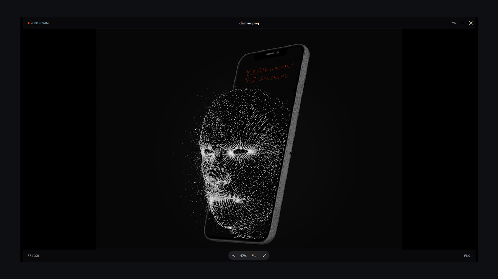

# NAVIG Glass

**Instant file viewer for Windows.** Images open in about 20 ms. Documents, video and audio are read by the codecs already inside Windows, so the whole program is **1 MB**.

[](../../releases/latest)



## Download & install

1. Download `navig-glass-0.2.0.zip` from [Releases](../../releases/latest), or just take `navig-glass.exe` from this repository.
2. Either **double-click `navig-glass.exe`** — it is portable, no install needed — or run the installer:

```powershell
powershell -ExecutionPolicy Bypass -File install.ps1
```

`install.ps1` is per-user and needs no admin rights. It copies the program to `%LOCALAPPDATA%\Programs\NAVIG Glass`, adds a Start-menu shortcut, a `navig-glass` command, and an **Open with** entry for 19 file types. It never changes your default apps. `uninstall.ps1` reverses all of it.

## What it opens

| | |
|---|---|
| **Images** | PNG, JPEG, WebP, GIF, BMP, TIFF, ICO, AVIF, HEIC, JXL — with ICC colour management, EXIF orientation, animated GIF/WebP and a transparency checkerboard |
| **Documents** | PDF page view; Left / Right / Home / End turn pages; rendering never blocks the window |
| **Video** | poster frame (first decodable frame) |
| **Audio** | a card with codec, sample rate, channels and bitrate |

## Speed

Measured on a Ryzen/Windows 11 machine, idle:

| | |
|---|---:|
| Cold open, small image | **19.9 ms** |
| Cold open, typical image | **21.4 ms** |
| Next image (p50 / p95) | **4.5 ms / 9.0 ms** |
| Memory | 52 MB |

The same binary still opens in 33–39 ms on a machine at 81 % load. That's the whole point of the project: a viewer should feel like the picture was always there.

## Keys

| Key | Action |
|---|---|
| ← / → | previous / next image (pages in a PDF) |
| + / − / Ctrl+wheel | zoom |
| F | fit to window |
| 0 | actual size |
| Space | toggle fit / 100 % |
| Shift + drag | rubber-band selection |
| Right-click | menu; inside a selection: copy, zoom to selection, clear |
| Esc | close |

## Peek

Leave NAVIG Glass running, select a file in Explorer and press **Space**. It resolves the selection through the Windows shell and shows the file in about 7–9 ms — no second process, no window creation.

## Why it is small

Images are decoded in-process with memory-mapped reads. PDF is rasterised by `Windows.Data.Pdf`, video and audio metadata come from Media Foundation — all part of Windows. Nothing is bundled twice, and there are no codec licences to carry.

## Scope

NAVIG Glass is a **viewer**. It does not play video, play audio, select PDF text or search inside documents. That is a deliberate boundary: playback needs an audio graph and A/V sync, which would cost both the instant open and the 1 MB footprint.

## Privacy

No network access, no telemetry, no accounts. Files never leave your machine. **Delete is permanent** — it removes the file from disk with no recycle bin.